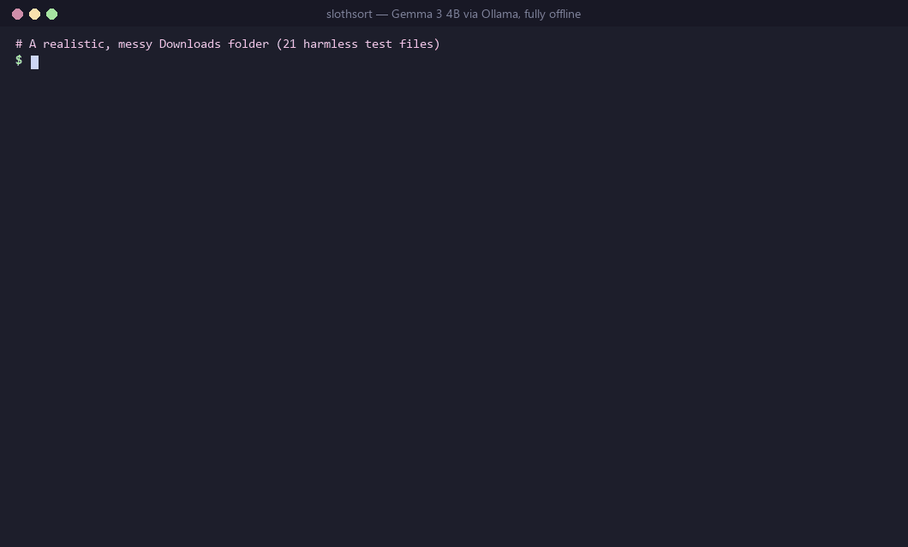

# 🦥 slothsort

**Tidy your Downloads folder without lifting a finger, or sending a single byte to the cloud.**



slothsort looks at every file in a messy folder, asks a small open-weight model running on your own machine (Gemma, via [Ollama](https://ollama.com)) what it is, and proposes a folder and a human-readable name for it:

```
Code/
   script (1).py
     -> 2026-09-26 hacker-news-top-stories.py   (Python script scrapes hacker news front page titles.)
Documents/
   Doc1.docx
     -> 2026-10-15 quarterly-report-q3-2026.docx   (Report details revenue growth and board meeting preparation.)
   Document (3).docx
     -> 2026-10-13 acme-corp-frontend-developer-cover.docx   (Clearly a cover letter for a developer role.)
Invoices & Receipts/
   download.txt
     -> 2026-10-12 apartment-4b-lease-renewal.txt   (Confirms lease renewal details with apartment address.)
   invoice_8812(1).txt
     -> 2026-10-07 tokopedia-invoice-wh-200.txt   (Clearly an invoice from Tokopedia for headphones.)
Screenshots/
   Screenshot 2026-10-01 101010.png
     -> screenshot-2026-10-01-101010.png   (matched by file extension)
...
20 file(s), 10 folder(s). Roughly 8 minute(s) of clicking you won't have to do.
This was a dry run. Add --apply to move the files.
```

*(Real output from `gemma3:4b` on the demo folder, trimmed. 94 seconds on a laptop CPU.)*

It's built for sloths, so it's also built to be safe:

- **Dry run by default.** Nothing moves until you add `--apply`.
- **One-command undo.** `slothsort --undo` puts the last run back exactly as it was.
- **Never overwrites.** Name clashes get a `-2`, `-3` suffix.
- **Leaves half-finished downloads alone** (`.crdownload`, `.part`, files touched in the last 2 minutes).
- **Remembers its answers.** Results are cached per file, so re-runs are instant and the model only sees new arrivals.
- **Works without a model too.** No Ollama? It falls back to sorting by extension.
- **Zero dependencies.** One Python file, standard library only.

## Quick start

```bash
# 1. Install Ollama from https://ollama.com, then pull a small Gemma model
ollama pull gemma3:4b        # ~3.3 GB; use gemma3:1b on low-RAM machines

# 2. See what slothsort would do (moves nothing)
python slothsort.py ~/Downloads

# 3. Like it? Do it.
python slothsort.py ~/Downloads --apply

# 4. Didn't like it? Undo.
python slothsort.py ~/Downloads --undo
```

## Set it up once, never think about it again

**Windows** (runs every night at 3 AM):

```powershell
schtasks /Create /SC DAILY /ST 03:00 /TN slothsort /TR "python C:\path\to\slothsort.py %USERPROFILE%\Downloads --apply"
```

**macOS / Linux** (`crontab -e`):

```
0 3 * * * python3 /path/to/slothsort.py ~/Downloads --apply
```

## Options

| Flag | What it does |
| --- | --- |
| `--apply` | Actually move files (otherwise it's a dry run) |
| `--undo` | Reverse the last applied run |
| `--model NAME` | Any Ollama model (default `gemma3:4b`, or `$SLOTHSORT_MODEL`) |
| `--host URL` | Ollama server (default `http://localhost:11434`, or `$OLLAMA_HOST`) |
| `--no-ai` | Skip the model, sort by extension only |
| `--cpu` | Run the model on the CPU (happens automatically if the GPU can't load it) |
| `--no-date` | Don't prefix new names with the file's date |
| `--settle N` | Ignore files modified in the last N seconds (default 120) |
| `--limit N` | Only look at the first N files |
| `--json` | Print the plan as JSON (for scripting) |

PDF text is read if you `pip install pypdf`; `.docx`, `.pptx`, `.xlsx` and plain-text files are read with the standard library.

## How it works

1. **Scan** the top level of the folder, skip anything hidden, partial or brand new.
2. **Peek** at up to 1,200 characters of each file's text.
3. **Ask** the local model for `{category, name, reason}`, using Ollama's structured outputs with a JSON schema. The file's extension decides which folders are allowed (a `.py` can only be Code; a `.txt` can be Documents or Invoices & Receipts), so the model picks among sensible options and can't misfile. Files with no readable text skip the model and just get their name tidied.
4. **Plan** destinations as `Category/YYYY-MM-DD descriptive-name.ext`, resolving clashes.
5. **Apply** moves one at a time, logging each one to `.slothsort/history.jsonl` as it happens, so even an interrupted run can be undone.

## Try it on a fake messy folder

```bash
python make_demo_folder.py demo-downloads   # 21 realistic, harmless files
python slothsort.py demo-downloads
```

## Tests

```bash
python -m unittest -v test_slothsort
```

The tests spin up a fake Ollama server, so they run in under a second with no model installed.

## License

MIT
